<div align="center">

<a href="https://github.com/AhmetKoca32">
  
</a>

**Backend & Full-Stack Developer** · Flutter · Applied AI

[](https://www.linkedin.com/in/ahmetkocaa/)
[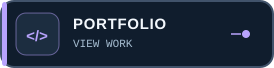](https://ahmet-koca-portfolio.vercel.app/)
[](mailto:kocaahmetkoca32@gmail.com)

<sub>Computer Engineering graduate · Süleyman Demirel University · Türkiye</sub>

</div>

---

## `01 // WHOAMI`

```terminal
$ whoami
ahmet-koca

$ cat current-focus.txt
Backend systems · Full-stack engineering · Applied AI · Flutter

$ git status --short
 M always-learning
```

I build **Python/FastAPI services**, mobile apps with **Flutter**, and AI-enabled experiences that solve practical problems. I enjoy taking features from an idea through architecture, integration, testing, and reliable delivery.

---

## `02 // SELECT YOUR MISSION`

<div align="center">
<a href="https://github.com/AhmetKoca32/zerowaste">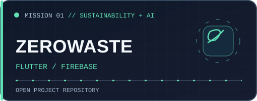</a>
<a href="https://github.com/AhmetKoca32/Shoplytic">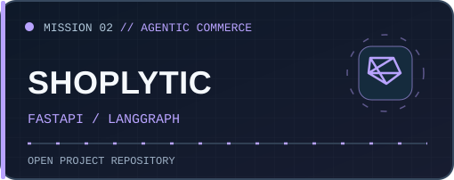</a>
<a href="https://github.com/AhmetKoca32/Stayzi">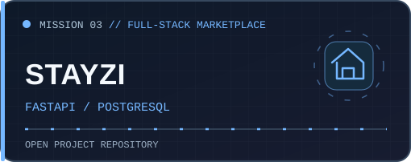</a>
<a href="https://github.com/AhmetKoca32/AI-180">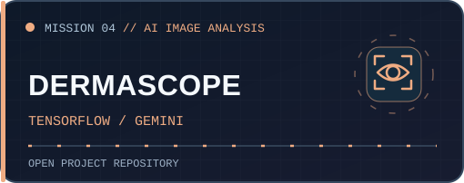</a>
<a href="https://github.com/AhmetKoca32/ZoneRun">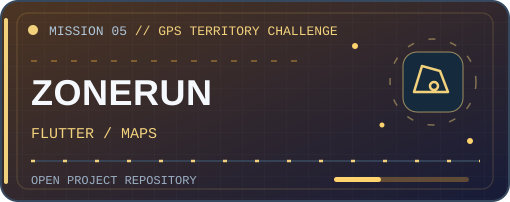</a>
<a href="https://github.com/AhmetKoca32/ChatBot_with_RAG">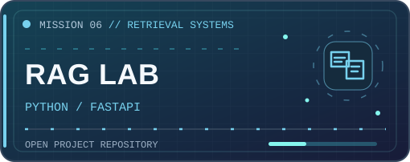</a>
</div>

<details>
<summary><b>READ MISSION BRIEFINGS</b></summary>

| Mission | Project briefing |
|:--|:--|
| **[ZeroWaste Kitchen](https://github.com/AhmetKoca32/zerowaste)** | Erasmus+ KA210 mobile app exploring AI-assisted recipes, EcoChef and food-waste awareness |
| **[Shoplytic](https://github.com/AhmetKoca32/Shoplytic)** | AI-driven shopping assistance, mind maps and personalized needs analysis |
| **[Stayzi](https://github.com/AhmetKoca32/Stayzi)** | Team-built Flutter and FastAPI accommodation marketplace prototype |
| **[DermaScope](https://github.com/AhmetKoca32/AI-180)** | Bootcamp prototype combining image analysis and informational AI guidance |
| **[ZoneRun](https://github.com/AhmetKoca32/ZoneRun)** | GPS territory capture with polygon geometry and activity statistics |
| **[RAG Lab](https://github.com/AhmetKoca32/ChatBot_with_RAG)** | Learning and experimentation with retrieval-augmented chat architecture |

These projects include team, research and learning prototypes. See each repository for details, implementation status and limitations.

</details>

---

## `03 // LIVE DATA FLOW`

<div align="center">
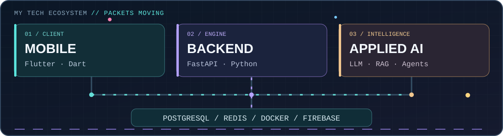
</div>

<details>
<summary><b>EXPAND TECH STACK</b></summary>

| Category | Technologies |
|:--|:--|
| **Languages** | Python, Dart, SQL, JavaScript and TypeScript |
| **Backend** | FastAPI, REST, SQLAlchemy, PostgreSQL, Redis, RabbitMQ |
| **Mobile / Cloud** | Flutter, Firebase, Google Maps |
| **Applied AI** | LLM APIs, RAG, LangGraph, model integrations |
| **Delivery** | Docker, Git, GitHub Actions |

</details>

---

## `04 // ACHIEVEMENTS UNLOCKED`

<div align="center">
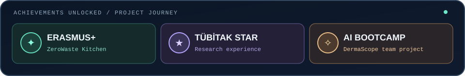
</div>

- **Erasmus+ ZeroWaste Kitchen:** Flutter mobile development for an international sustainability initiative.
- **TÜBİTAK 1001 STING:** STAR research contribution to digital-health software workflows.
- **AI & Technology Academy:** Worked on DermaScope as a collaborative bootcamp project.

---

## `05 // CONTRIBUTION QUEST`

<div align="center">
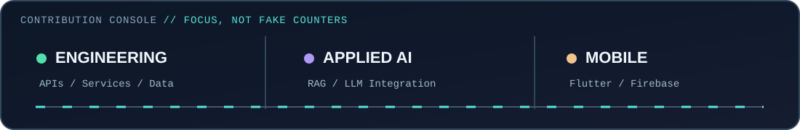

<picture>
  <source media="(prefers-color-scheme: dark)" srcset="https://raw.githubusercontent.com/AhmetKoca32/AhmetKoca32/output/github-contribution-grid-snake-dark.svg" />
  <source media="(prefers-color-scheme: light)" srcset="https://raw.githubusercontent.com/AhmetKoca32/AhmetKoca32/output/github-contribution-grid-snake.svg" />
  
</picture>

<sub>The activity panel shows technical focus areas, not invented GitHub contribution totals. The snake is generated separately by the existing GitHub Actions workflow.</sub>

</div>

---

## `06 // TRANSMISSION`

<div align="center">

[](https://www.linkedin.com/in/ahmetkocaa/)
[](https://ahmet-koca-portfolio.vercel.app/)
[](mailto:kocaahmetkoca32@gmail.com)

<sub>AHMETOS V3.0 · Original SVG animations · Reduced-motion support · No fragile badge or third-party statistics image dependencies.</sub>

</div>
