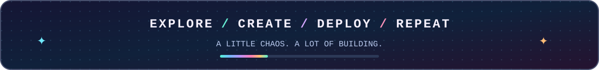
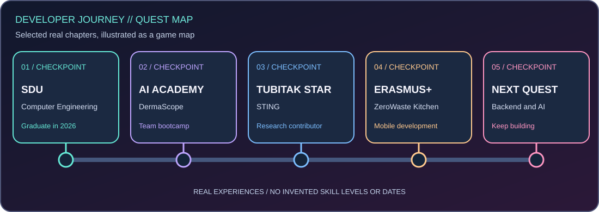
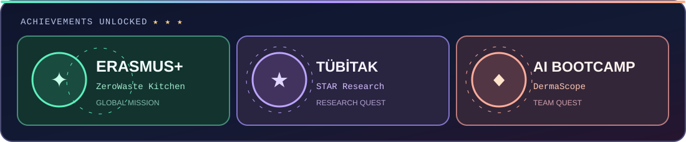
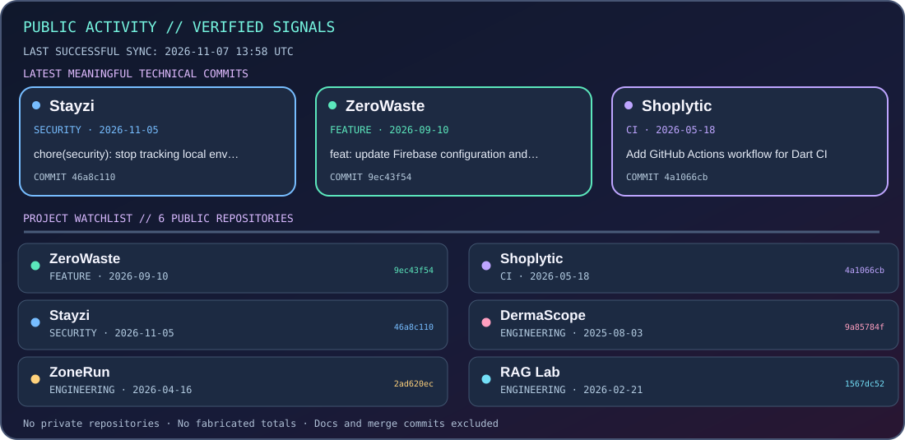
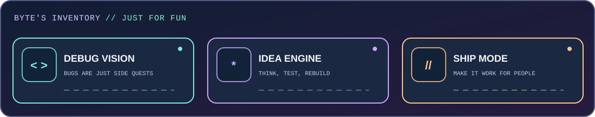

<div align="center">

<a href="https://github.com/AhmetKoca32">
  
</a>





### MEET BYTE · YOUR CODING SIDEKICK

*Pixel-perfect? Probably not. Curious and always building? Absolutely.*

**Backend & Full-Stack Developer** · Flutter · Applied AI · Creative Engineering

[](https://www.linkedin.com/in/ahmetkocaa/)
[](https://ahmet-koca-portfolio.vercel.app/)
[](mailto:kocaahmetkoca32@gmail.com)

<sub>Computer Engineering graduate · Süleyman Demirel University · Türkiye</sub>

</div>

---

## `01 // WHOAMI`

```terminal
$ whoami
ahmet-koca

$ cat current-focus.txt
Backend systems · Full-stack engineering · Applied AI · Flutter

$ git status --short
 M always-learning
```

I build **Python/FastAPI services**, mobile apps with **Flutter**, and AI-enabled experiences that solve practical problems. I enjoy taking features from an idea through architecture, integration, testing, and reliable delivery.

---

## `02 // SELECT YOUR MISSION` 

*Six quests, six different tech stacks. Pick one and explore the source.*

<div align="center">
<a href="https://github.com/AhmetKoca32/zerowaste"></a>
<a href="https://github.com/AhmetKoca32/Shoplytic"></a>
<a href="https://github.com/AhmetKoca32/Stayzi"></a>
<a href="https://github.com/AhmetKoca32/AI-180"></a>
<a href="https://github.com/AhmetKoca32/ZoneRun"></a>
<a href="https://github.com/AhmetKoca32/ChatBot_with_RAG"></a>
</div>

<details>
<summary><b>READ MISSION BRIEFINGS</b></summary>

| Mission | Project briefing |
|:--|:--|
| **[ZeroWaste Kitchen](https://github.com/AhmetKoca32/zerowaste)** | Erasmus+ KA210 mobile app exploring AI-assisted recipes, EcoChef and food-waste awareness |
| **[Shoplytic](https://github.com/AhmetKoca32/Shoplytic)** | AI-driven shopping assistance, mind maps and personalized needs analysis |
| **[Stayzi](https://github.com/AhmetKoca32/Stayzi)** | Team-built Flutter and FastAPI accommodation marketplace prototype |
| **[DermaScope](https://github.com/AhmetKoca32/AI-180)** | Bootcamp prototype combining image analysis and informational AI guidance |
| **[ZoneRun](https://github.com/AhmetKoca32/ZoneRun)** | GPS territory capture with polygon geometry and activity statistics |
| **[RAG Lab](https://github.com/AhmetKoca32/ChatBot_with_RAG)** | Learning and experimentation with retrieval-augmented chat architecture |

These projects include team, research and learning prototypes. See each repository for details, implementation status and limitations.

</details>

---

## `03 // SKILL TREE`

<div align="center">

</div>

> Every branch represents technologies explored in real projects. These are not invented proficiency scores or game levels.

---

## `04 // DEVELOPER JOURNEY`

<div align="center">

</div>

The checkpoints show **selected experiences**, not a precise dated chronology. Some are team projects, and the final checkpoint represents a direction I'm working toward.

---

## `05 // LIVE DATA FLOW`

<div align="center">

</div>

<details>
<summary><b>EXPAND TECH STACK</b></summary>

| Category | Technologies |
|:--|:--|
| **Languages** | Python, Dart, SQL, JavaScript and TypeScript |
| **Backend** | FastAPI, REST, SQLAlchemy, PostgreSQL, Redis, RabbitMQ |
| **Mobile / Cloud** | Flutter, Firebase, Google Maps |
| **Applied AI** | LLM APIs, RAG, LangGraph, model integrations |
| **Delivery** | Docker, Git, GitHub Actions |

</details>

---

## `06 // ACHIEVEMENTS UNLOCKED`

<div align="center">

</div>

- **Erasmus+ ZeroWaste Kitchen:** Flutter mobile development for an international sustainability initiative.
- **TÜBİTAK 1001 STING:** STAR research contribution to digital-health software workflows.
- **AI & Technology Academy:** Worked on DermaScope as a collaborative bootcamp project.

---

## `07 // PUBLIC ACTIVITY + CONTRIBUTION QUEST` 

*XP isn't measured by invented counters. The contribution snake tells the story.*

<div align="center">




<sub>**Public activity dashboard:** Six public repositories, latest qualifying technical updates, and source commit identifiers. The initial snapshot was verified on 2026-11-06. Scheduled GitHub Actions refreshes begin only after this workflow reaches `main`; the refresh date will then be displayed inside the panel.</sub>

<details>
<summary><b>HOW THE ACTIVITY PANEL WORKS</b></summary>

- Source: public GitHub API for [ZeroWaste](https://github.com/AhmetKoca32/zerowaste), [Shoplytic](https://github.com/AhmetKoca32/Shoplytic), [Stayzi](https://github.com/AhmetKoca32/Stayzi), [DermaScope](https://github.com/AhmetKoca32/AI-180), [ZoneRun](https://github.com/AhmetKoca32/ZoneRun), and [RAG Lab](https://github.com/AhmetKoca32/ChatBot_with_RAG).
- Shows the latest qualifying non-merge, non-documentation commit in each project, with up to three recent updates highlighted.
- Updated daily via [GitHub Actions](.github/workflows/profile-activity.yml), subject to repository workflow permissions and a successful run.
- No private repositories, invented experience points, or fake GitHub totals. The panel is a selected public project activity feed, **not** a complete GitHub contribution counter.

</details>

<picture>
  <source media="(prefers-color-scheme: dark)" srcset="https://raw.githubusercontent.com/AhmetKoca32/AhmetKoca32/output/github-contribution-grid-snake-dark.svg" />
  <source media="(prefers-color-scheme: light)" srcset="https://raw.githubusercontent.com/AhmetKoca32/AhmetKoca32/output/github-contribution-grid-snake.svg" />
  
</picture>

<sub>The activity panel shows technical focus areas, not invented GitHub contribution totals. The snake is generated separately by the existing GitHub Actions workflow.</sub>

</div>

---

## `08 // SECRET LEVEL`

<details>
<summary><b>🎮 UNLOCK SECRET QUEST · Byte's hidden developer console</b></summary>

<div align="center">





</div>

```text
byte@ahmetos:~$ ./mission --secret
> CURIOSITY: DETECTED
> DEBUG MODE: UNLOCKED
> NEXT QUEST: BUILD SOMETHING USEFUL

byte@ahmetos:~$ sudo hire ahmet
> This is a joke command, not a real terminal.
> Want a real conversation? Use the links below.
```

**Secret mission completed:** You found Byte's hidden arcade inventory. The power-ups are playful labels, not certifications or measurable GitHub scores.

[Contact on LinkedIn](https://www.linkedin.com/in/ahmetkocaa/) · [Explore the projects](https://github.com/AhmetKoca32?tab=repositories)

</details>

<details>
<summary><b>⌨️ BONUS COMMAND · cat /etc/ahmetos/manifesto</b></summary>

```text
$ cat /etc/ahmetos/manifesto
Make it useful.
Make it maintainable.
Learn from the bugs.
Ship, iterate, repeat.
```

</details>

---

## `09 // TRANSMISSION`

<div align="center">


[](https://www.linkedin.com/in/ahmetkocaa/)
[](https://ahmet-koca-portfolio.vercel.app/)
[](mailto:kocaahmetkoca32@gmail.com)

<sub>AHMETOS V4.0 PIXEL ARCADE · Original SVG animations · Reduced-motion support · No fragile badge or third-party statistics image dependencies.</sub>

</div>
