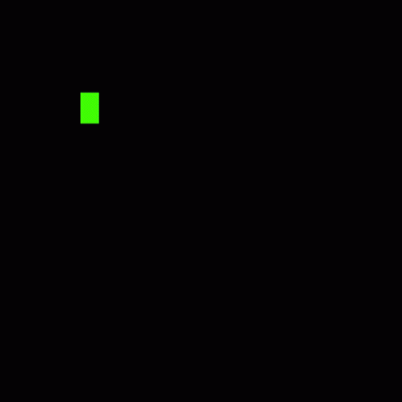

<picture>
  <source media="(prefers-color-scheme: dark)" srcset="https://raw.githubusercontent.com/AhmetKoca32/AhmetKoca32/output/github-contribution-grid-snake-dark.svg">
  <source media="(prefers-color-scheme: light)" srcset="https://raw.githubusercontent.com/AhmetKoca32/AhmetKoca32/output/github-contribution-grid-snake.svg">
  
</picture>

---

 

    
    

---

## Languages and Tools:

  <!-- Flutter -->
  
  <!-- Dart -->
  
  <!-- Figma -->
  
  <!-- Firebase -->
  
  <!-- Docker -->
  
  <!-- Google Cloud Platform -->
  <!--img src="https://img.icons8.com/color/48/000000/google-cloud.png" alt="Google Cloud Platform" width="40" height="40"/>
  <!-- Git -->
  
  <!-- MySQL -->
  
  <!-- SQLite -->
  
  <!-- PostgreSQL -->
  
  <!-- FastAPI -->
  
  <!-- GraphQL -->
  
  <!-- Django -->
  
  <!-- Django Rest Framework-->
  
  <!-- Flask -->
  
  <!-- Kubernetes -->
  <!--img src="https://img.icons8.com/color/48/000000/kubernetes.png" alt="Kubernetes" width="40" height="40"/>
  <!-- Redis -->
  
  <!-- Celery -->
  
  <!-- Java -->
  <!--img src="https://img.icons8.com/color/48/000000/java-coffee-cup-logo.png" alt="Java" width="40" height="40"/>
  <!-- Android (Java) -->
  <!--img src="https://img.icons8.com/color/48/000000/android-os.png" alt="Android" width="40" height="40"/>
  <!-- HTML -->
  
  <!-- CSS -->
  
  <!-- JavaScript -->
  
  <!-- Python -->
  
  <!-- C -->
  
  <!-- Unity -->
<!--    -->
  <!-- Spring Boot -->
  

## Connect With Me

  <!-- Email -->
  
  <!-- LinkedIn -->
  
  <!-- Instagram -->
  
  <!-- Medium -->

<!-- Portfolio -->

## About Me

- 🎓 Computer Engineering graduate from **Süleyman Demirel University**.
- 💻 I focus on **Backend & Full-Stack Development**, while continuing to build mobile applications with Flutter.
- 🛠️ My core stack includes **Python, FastAPI, PostgreSQL, Redis, Docker, Flutter, and Firebase**.
- 🤖 Interested in **Applied AI, RAG, AI-enabled workflows**, and reliable backend systems.
- 🌍 Contributed to the **Erasmus+ ZeroWaste Kitchen** project and **TÜBİTAK 1001 STING** research.
- 🚀 I enjoy turning ideas into working software and learning from real project constraints.

## GitHub Stats

### Streak Stats

### Most Used Languages 

## Featured Projects

- **[ZeroWaste Kitchen](https://github.com/AhmetKoca32/zerowaste)**: Erasmus+ KA210 mobile application tackling food-waste awareness through AI-assisted recipe generation, EcoChef chat, and gamification. **Flutter, Firebase, Cloud Functions, DeepSeek**.
- **[Shoplytic](https://github.com/AhmetKoca32/Shoplytic)**: AI-assisted shopping application with needs analysis, mind maps, and product recommendations. **Flutter, FastAPI, LangGraph**.
- **[Stayzi](https://github.com/AhmetKoca32/Stayzi)**: Team-built accommodation marketplace prototype with property listings, profiles, and backend service integrations. **Flutter, FastAPI, PostgreSQL, Redis, RabbitMQ**.
- **[DermaScope](https://github.com/AhmetKoca32/AI-180)**: Academy bootcamp prototype combining skin-image analysis and informational AI guidance. **Flutter, FastAPI, TensorFlow/Keras, Gemini**.
- **[ZoneRun](https://github.com/AhmetKoca32/ZoneRun)**: GPS-based territory challenge with polygon area calculation, history, and activity statistics. **Flutter, Google Maps, SQLite, Firebase**.
- **[ChatBot with RAG](https://github.com/AhmetKoca32/ChatBot_with_RAG)**: Exploration of retrieval-augmented chat using FastAPI and Streamlit.
- **[EcoTale](https://github.com/AhmetKoca32/EcoTale)**: Environmental storytelling prototype with Gemini and text-to-speech.

**Research:** [STING – TÜBİTAK 1001](https://github.com/tubitaksting), a childhood drug-repurposing research initiative in which I contributed to software development.

These include academic, research, and prototype projects; individual repositories document their implementation and current limitations.
