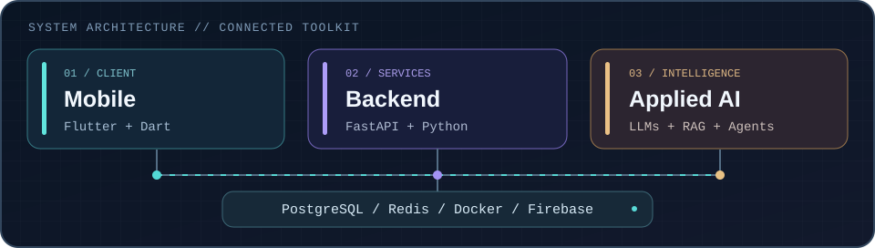

<div align="center">



<a href="https://github.com/AhmetKoca32"></a>

[](https://www.linkedin.com/in/ahmetkocaa/)
[](https://ahmet-koca-portfolio.vercel.app/)
[](mailto:kocaahmetkoca32@gmail.com)

<sub>Computer Engineering graduate · Süleyman Demirel University · Türkiye</sub>

</div>

---

## `01 // WHOAMI`

```bash
$ whoami
ahmet-koca

$ cat focus.txt
Backend engineering | Full-stack products | Applied AI | Flutter

$ echo $MISSION
Build useful software. Make it reliable. Keep learning.
```

I develop **Python/FastAPI backends**, mobile experiences with **Flutter**, and **AI-enabled applications**. My work spans data-driven APIs, PostgreSQL and Redis integrations, Firebase, and LLM/RAG-based workflows. I enjoy taking ideas from architecture to something people can actually use.

---

## `02 // SELECT A MISSION`

<div align="center">

<a href="https://github.com/AhmetKoca32/zerowaste"></a>
<a href="https://github.com/AhmetKoca32/Shoplytic"></a>
<a href="https://github.com/AhmetKoca32/Stayzi"></a>
<a href="https://github.com/AhmetKoca32/AI-180"></a>
<a href="https://github.com/AhmetKoca32/ZoneRun"></a>
<a href="https://github.com/AhmetKoca32/ChatBot_with_RAG"></a>

</div>

<details>
<summary><b>Mission briefing: what these projects do</b></summary>

| Project | Story |
|:--|:--|
| **[ZeroWaste Kitchen](https://github.com/AhmetKoca32/zerowaste)** | Erasmus+ KA210 food-waste awareness app with AI recipes, EcoChef and gamification |
| **[Shoplytic](https://github.com/AhmetKoca32/Shoplytic)** | AI-assisted commerce workflows with personalized needs analysis and product exploration |
| **[Stayzi](https://github.com/AhmetKoca32/Stayzi)** | Collaborative full-stack accommodation marketplace prototype |
| **[DermaScope](https://github.com/AhmetKoca32/AI-180)** | Bootcamp mobile prototype combining image analysis with informational AI guidance |
| **[ZoneRun](https://github.com/AhmetKoca32/ZoneRun)** | GPS territory-tracking experience using polygon area calculations |
| **[RAG Lab](https://github.com/AhmetKoca32/ChatBot_with_RAG)** | Exploration of retrieval-augmented chatbot architecture |

Some projects are team or educational prototypes, not production deployments. Each repository describes its own implementation and limitations.

</details>

---

## `03 // SYSTEM ARCHITECTURE`

<div align="center">

</div>

<details>
<summary><b>Show the toolkit</b></summary>

| Layer | Tools & technologies |
|:--|:--|
| **Languages** | Python, Dart, SQL, JavaScript / TypeScript |
| **Backends & APIs** | FastAPI, REST, SQLAlchemy, authentication, background services |
| **Data & infrastructure** | PostgreSQL, Redis, RabbitMQ, Docker, Git, GitHub Actions |
| **Mobile & cloud** | Flutter, Firebase, Google Maps |
| **Applied AI** | LLM APIs, RAG, LangGraph, model/API integration |

</details>

---

## `04 // ACHIEVEMENTS UNLOCKED`

<div align="center">

</div>

- **Erasmus+ ZeroWaste Kitchen:** Flutter mobile development for an international sustainability initiative.
- **TÜBİTAK 1001 STING:** STAR research contribution to software and digital-health workflows.
- **Artificial Intelligence & Technology Academy:** Collaborative development of the DermaScope prototype.

---

## `05 // CONTRIBUTION QUEST`

<div align="center">

<sub>Even side quests count.</sub>

<picture>
  <source media="(prefers-color-scheme: dark)" srcset="https://raw.githubusercontent.com/AhmetKoca32/AhmetKoca32/output/github-contribution-grid-snake-dark.svg">
  <source media="(prefers-color-scheme: light)" srcset="https://raw.githubusercontent.com/AhmetKoca32/AhmetKoca32/output/github-contribution-grid-snake.svg">
  
</picture>


</div>

---

## `06 // TRANSMISSION`

<div align="center">

**Have an interesting backend, full-stack, or applied AI challenge?**

[**LinkedIn**](https://www.linkedin.com/in/ahmetkocaa/) · [**Email**](mailto:kocaahmetkoca32@gmail.com) · [**Portfolio**](https://ahmet-koca-portfolio.vercel.app/)


<sub>`AHMET_OS v2.0` · Built with Markdown, GitHub-friendly SVG animation, and a completely unnecessary amount of enthusiasm for developer interfaces.</sub>

</div>
